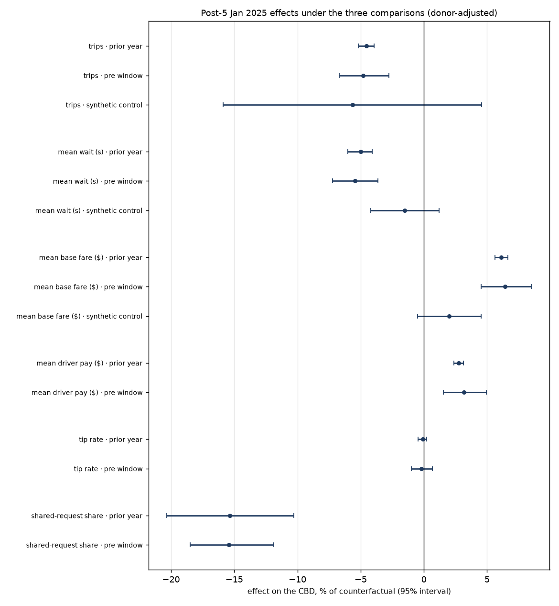

# roundtrip

NYC ride-hail marketplace economics on live public data. A re-running monthly pipeline over
the TLC High Volume For-Hire Vehicle trip records (Uber and Lyft, 15–20 million trips a
month), with causal inference, heterogeneous-effect estimation and standard ML on top, and a
human review gate before anything is published.



Public site: https://roundtrip.vikramrai.com (the last approved release, with the
reviewer's notes).

**Headline (release 2026-08, approved with notes).** In the first year of congestion
pricing (5 January 2025 to 3 January 2026), relative to the counterfactual and net of what
happened in comparable zones outside the CBD:

| Outcome | Prior-year comparison | Synthetic control | Pre-window comparison |
|---|---|---|---|
| CBD pickups | -4.6% [-5.2, -3.9] | -5.6% [-15.9, +4.6] | -4.8% [-6.7, -2.8] |
| Mean wait for a car | -5.0% [-6.0, -4.1] | -1.5% [-4.2, +1.2] | -5.4% [-7.2, -3.6] |
| Mean base fare | +6.1% [+5.6, +6.6] | +2.0% [-0.5, +4.5] | +6.4% [+4.5, +8.5] |

95% intervals; the synthetic control's are placebo-based and conservative. Full report
with diagnostics, placebos and limitations: [REPORTS/congestion_pricing.md](REPORTS/congestion_pricing.md).
Numbers on main may be a newer candidate than the published release; see
[releases/index.json](releases/index.json) for what has been approved, by whom and with
what notes. The reviewer's note on 2026-08: the CBD was losing trip share throughout 2024,
which complicates the event study design and the synthetic control.

**Status: phase 2 (event study, synthetic control, report, review gate).**

| Phase | Scope | State |
|---|---|---|
| 1 | Config, ingest, validation suite, zone-hour panel, CI green | done; 44 months in R2 |
| 2 | Congestion-pricing analyses, diagnostics, first report, review gate, candidate PR end to end | this PR; HTE causal forest deferred |
| 3 | Wait-time and driver-pay models with drift monitoring; uplift on an RCT | later |
| 4 | Optional: Chicago, weather, interactive site | maybe |

## Phase 1 on real data

Two months processed end to end on the standard GitHub Actions runner from the
`phase-1/scaffold` branch (runs 40607735699 and 40607914444), no R2 configured, outputs kept
as workflow artifacts:

| Month | Rows | Raw size | Wall time | Peak RSS | Validation | Schema | Panel | Sample |
|---|---|---|---|---|---|---|---|---|
| 2024-12 | 21,068,851 | 507 MB | 19 s | 2.3 GB | pass | hvfhv-2019 | 365,227 rows, 23 MB | 96,758 rows, 3.7 MB |
| 2025-01 | 20,405,666 | 491 MB | 23 s | 2.2 GB | pass | hvfhv-2025-cbd | 364,630 rows, 23 MB | 96,774 rows, 3.7 MB |

Well inside the 10 GB DuckDB cap, so a 44-month backfill is about 20 minutes of runner
time. At ~27 MB of derived output per month the R2 footprint for 2023-01 to date is about
1.2 GB, inside the 2 GB target; rounding panel floats or trimming columns would halve it if
needed later.

Things the reviewer should know from these two months:

- 1.2% of trips in every month checked have a pickup timestamp earlier than the request
  timestamp (221k of 18.5M in January 2023). This is a steady reporting quirk, and the
  affected trips are excluded from wait-time means. Owner decision: the check stays hard
  with its own 5% limit (`max_pickup_before_request_share`), so only a real break stops
  the run.
- `on_scene_datetime` and `originating_base_num` are null for about 25% of trips through
  February 2025 (Lyft did not report them). From March 2025 `on_scene_datetime` is filled
  for all but 4.5% of trips. The null-rate check treats a fall like this as a soft warning
  and a rise as a hard failure.
- In January 2025 the mean `cbd_congestion_fee` on pickups in the 38 CBD zones is $1.48
  (the per-trip charge is $1.50) versus $0.14 elsewhere, which is consistent with the MTA
  zone list used in `config.py`.

## What runs every month

1. **Discover.** Probe TLC's CDN for months not yet in the manifest (one HEAD request per
   month from the configured start month to today).
2. **Ingest.** Stream the month's parquet (~500–700 MB) to a transient cache, computing its
   SHA-256 as it streams. Record size, hash, ETag, row count and column types in
   `manifest.json`. The raw file is deleted at the end of the job; TLC is the archive.
3. **Validate.** Schema (versioned by month; `cbd_congestion_fee` appears in 2025), row count
   against the trailing-12-month median, null-rate bands against history, timestamp order
   and month membership, fare and pay sanity, zone IDs against the lookup, licence codes
   against known bases. Hard failures stop the run and open a GitHub issue. The report is
   written as JSON and Markdown and attached to the candidate PR.
4. **Build.** A zone-hour panel (pickup zone × hour × base: trip counts, waits, fares,
   surcharges, driver pay, tip rate, shared-ride shares) and a fixed-seed stratified
   trip-level sample with sampling weights, both as parquet.
5. **Record.** A `run.json` with git SHA, manifest hash, package versions and the full
   config. Derived outputs are mirrored to Cloudflare R2 under 2 GB total.
6. **Analyse.** On the full panel: synthetic control for the CBD (with the 2023 test
   window and placebo-in-space), the three comparisons (prior year, synthetic control,
   pre-window), zone-week event studies against two control groups with pre-trend tests,
   fake-date and fake-zone placebos. One `estimates.json` bundle plus figures.
7. **Report and candidate PR.** `REPORTS/congestion_pricing.md` is rebuilt from the bundle
   with a review dashboard (validation table, estimates side by side with the last
   approved release, what changed). The PR `candidate: YYYY-MM` carries the report, the
   review record to fill in, the validation reports and the manifest.

Processing one month is one GitHub Actions job (4 cores, 16 GB; DuckDB capped at 10 GB
and 4 threads). The backfill workflow loops over a range of months sequentially and prints
peak RSS and wall time per month to the job summary.

## Data

- **TLC HVFHV trip records**, monthly parquet, 2023-01 onward (confirmed by the owner;
  `ROUNDTRIP_START_MONTH`). Fields: request, on-scene, pickup and dropoff
  times; pickup and dropoff zone; miles and time; base fare, tolls, surcharges, tips, driver
  pay; shared and accessible-vehicle flags; dispatching base.
- **TLC taxi zone lookup** (265 zones with borough).
- **CBD zones**: the 38 taxi zones in the MTA's Central Business District Taxi Zones
  dataset, hard-coded in `config.py` with the source noted. Owner to confirm boundary
  treatment before estimation.

Raw data never enters git or R2. Only derived outputs do.

## Review process

The owner (an economist) is the reviewer. Every candidate PR carries the validation
reports, the estimates side by side with the last approved release, placebo results and a
plain-language list of what changed, plus a link to a preview of the site built from the
candidate (a Cloudflare Pages preview deployment, marked "Not yet reviewed"). The review
works from a phone; nothing needs a shell or a Markdown editor:

1. Read the preview site, or `REPORTS/congestion_pricing.md` on the candidate PR, "What
   the reviewer should look at" first.
2. Open the review form linked from the PR (a GitHub issue form with the month and run id
   filled in), answer it, submit. The `review` workflow writes `reviews/YYYY-MM.md` from
   the answers, checks it, and refuses a form whose run id is not the candidate's. On
   approval it merges the PR and starts `publish.yml`; on rejection it records the reason
   in `releases/index.json` and closes the PR. Only the repository owner, or logins in the
   `REVIEWERS` repository variable, can review.
3. Approve the deployment in the GitHub `release` environment (required reviewer: the
   owner; one tap in the GitHub app). `publish.yml` then records the approval in
   `releases/index.json`, keeps the approved `estimates.json` under `releases/YYYY-MM/`,
   builds the static site from `REPORTS/` and deploys it to Cloudflare Pages. The review
   issue gets the site URL and is closed.

The same record can be written by hand instead: fill in `reviews/YYYY-MM.md` (every
`_fill_` must go; the `review-check` workflow fails the PR otherwise), merge, run
`publish.yml` for that month, or reject with
`roundtrip release reject --month YYYY-MM --reason "..."`.

`releases/index.json` lists every approved and rejected run with git SHA, manifest hash,
reviewer and date, so git history shows, month by month, what was looked at and when the
answer was no. One-time setup for the owner: create the `release` environment in the
repository settings with yourself as required reviewer.

## Reproduce locally

```bash
uv sync                                  # Python 3.12, all deps, dev tools
uv run pytest                            # synthetic-data tests, < 1 min
uv run roundtrip discover                # which months TLC has that we do not
uv run roundtrip process-month -m 2024-12 --keep-raw   # ~1 GB download, a few minutes
uv run roundtrip validate -m 2024-12     # re-run checks on the cached raw file
uv run roundtrip build-panel -m 2024-12  # rebuild panel and sample from the cache
uv run roundtrip sync                    # pull derived outputs from R2 (needs .env)
uv run roundtrip run-causal              # analyses on every panel month on disk (~20 s)
uv run roundtrip report                  # REPORTS/congestion_pricing.md from the newest run
uv run roundtrip release prepare -m 2026-08   # review record from the template
uv run roundtrip build-site --out site   # static HTML from REPORTS/
```

Outputs land under `data/derived/` (git-ignored). Set `ROUNDTRIP_DATA_DIR` to keep the
DuckDB file and parquet mirror out of a synced folder. Copy `.env.example` to `.env` for R2
access; the pipeline runs without it.

Validation thresholds, zone lists, dates, seed and sample size are all in
`src/roundtrip/config.py` and overridable via `ROUNDTRIP_*` environment variables
(nested fields use `__`, e.g. `ROUNDTRIP_VALIDATION__ROW_COUNT_TOLERANCE=0.2`).

## Layout

```
src/roundtrip/
  config.py      settings, zone definitions, thresholds
  db.py          DuckDB connection, SQL templates, trips/zones views
  ingest/        TLC probing and streaming download, manifest
  validate/      versioned schema, check runner, report
  features/      zone-hour panel and trip sample
  pipeline.py    per-month orchestration, run.json
  storage/r2.py  R2 mirror (boto3, S3 API)
  causal/        data.py (zone-day statistics, zone groups), synth.py, comparisons.py,
                 event_study.py, run.py (estimates bundle), figures.py
  report/        build.py (REPORTS/*.md), summary.py (tables), site.py (static HTML)
  release.py     review gate: prepare / from-issue / check / approve / reject, releases/index.json
  cli.py         typer CLI
  models/ uplift/   phase 3
sql/
  views/         trips.sql, zones.sql
  checks/        timestamps, money, zones, bases
  panel/         zone_hour.sql, trip_sample.sql
  causal/        zone_day.sql
REPORTS/         candidate report, figures and the estimates bundle it was built from
reviews/         TEMPLATE.md and one record per candidate month
releases/        index.json (approved and rejected runs) and approved bundles
tests/           synthetic month generator, simulated causal panel; 60 tests
.github/workflows/
  ci.yml           ruff, mypy --strict, pytest on every PR
  backfill.yml     process a range of months, one job per month, with profiling
  monthly.yml      weekly: discover, process, push to R2, analyse, preview site, candidate PR
  analysis.yml     re-run the analyses and rebuild the report on demand
  review.yml       turn a submitted review issue form into the record; merge, publish or reject
  review-check.yml fail a candidate PR whose review record is unfilled
  publish.yml      release-environment approval, record it, deploy the site to Pages
.github/ISSUE_TEMPLATE/review.yml  the review form (works in a phone browser)
```

See [METHODS.md](METHODS.md) for how the code was produced and validated, including the use
of a coding agent.

## Owner decisions

Settled: data start month 2023-01; MIT licence; pickup-before-request check hard at 5%;
anticipation window 14 Nov 2024 to 4 Jan 2025 handled by a synthetic-control forecast
tested on the same window a year earlier; three comparisons for the event study (prior
year, synthetic control, June to November 2024 pre-window); the fare measure is the base
passenger fare, which excludes the congestion fee (details in METHODS.md);
R2 bucket and repo secrets in place
(the bucket secret may be named `R2_BUCKET` or `R2_BUCKET_NAME`, the workflows accept
either).

Still open:

- Whether to drop airport trips (default keeps them; `ROUNDTRIP_EXCLUDE_AIRPORT_TRIPS`).
  Note the panel can only drop airport pickup zones, not airport-bound trips from other
  zones; excluding the latter needs an extra set of panel columns and a re-backfill.
- Benchmark estimates to compare against (placeholder in the report).
- Whether the deferred pieces of the brief's section 6a are wanted next: causal-forest
  heterogeneity on zone-hour cells and hour-of-day splits.
