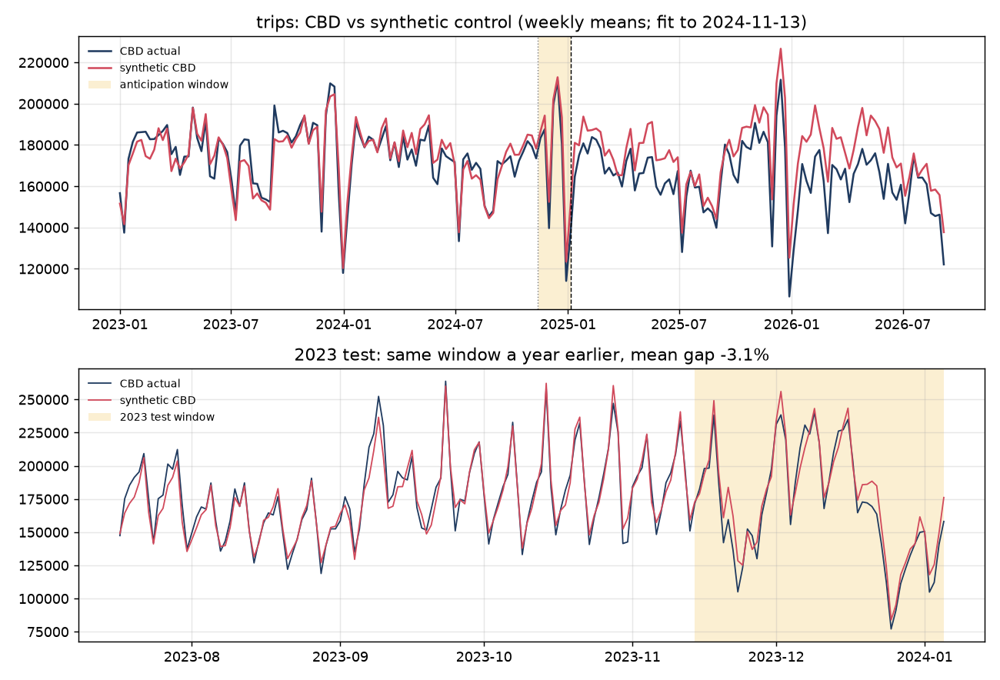
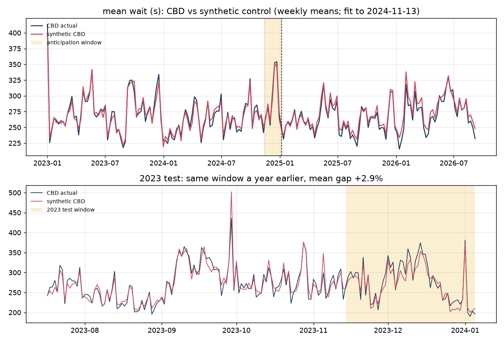
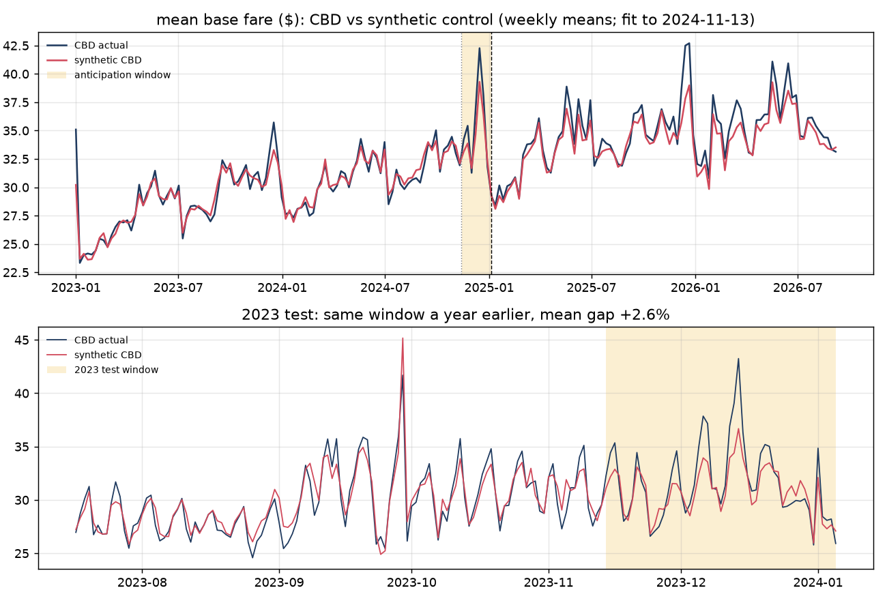
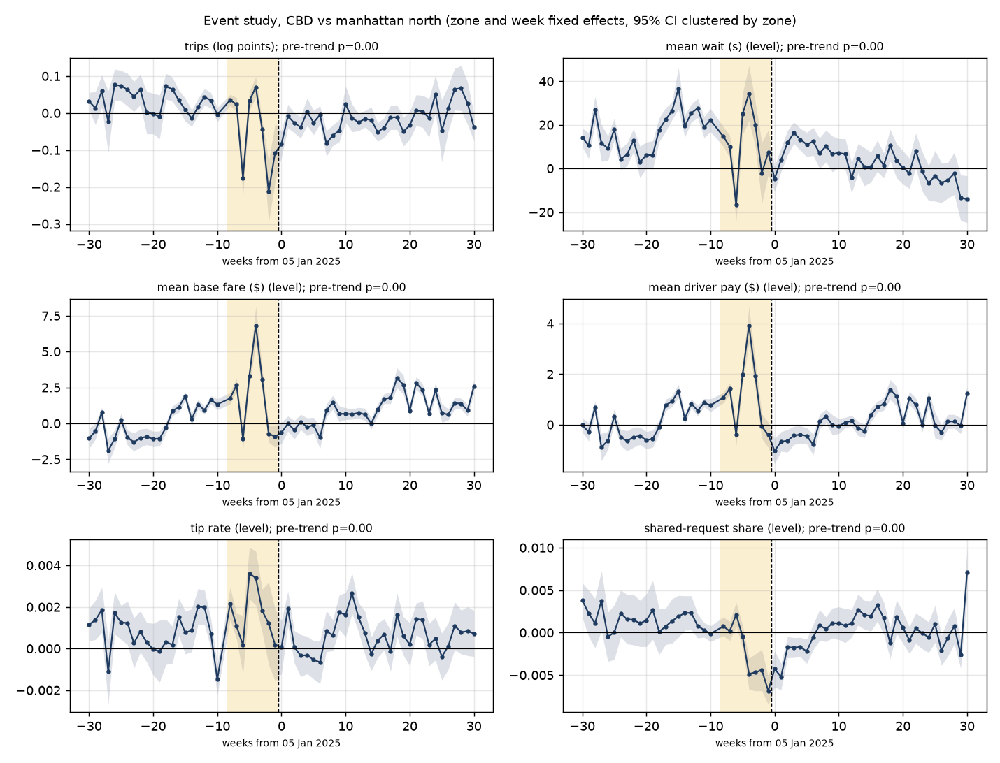
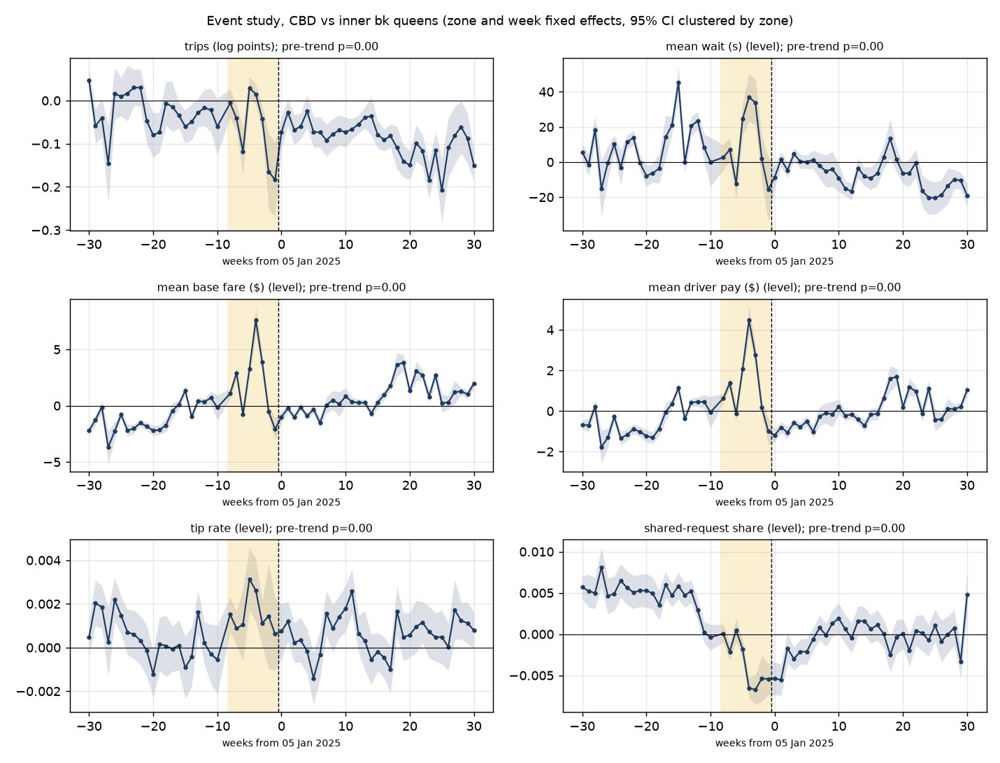
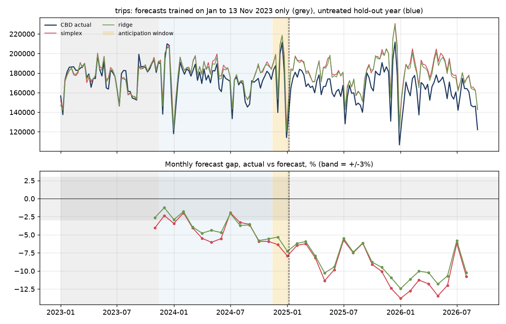
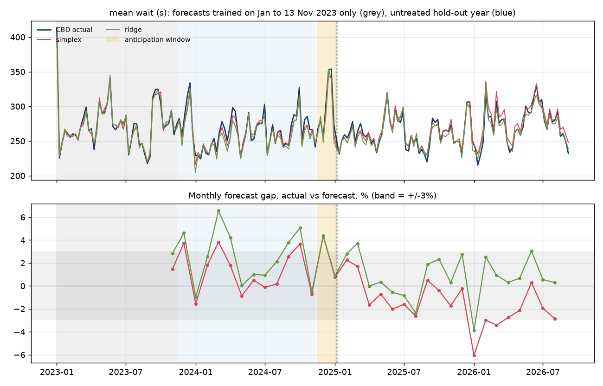
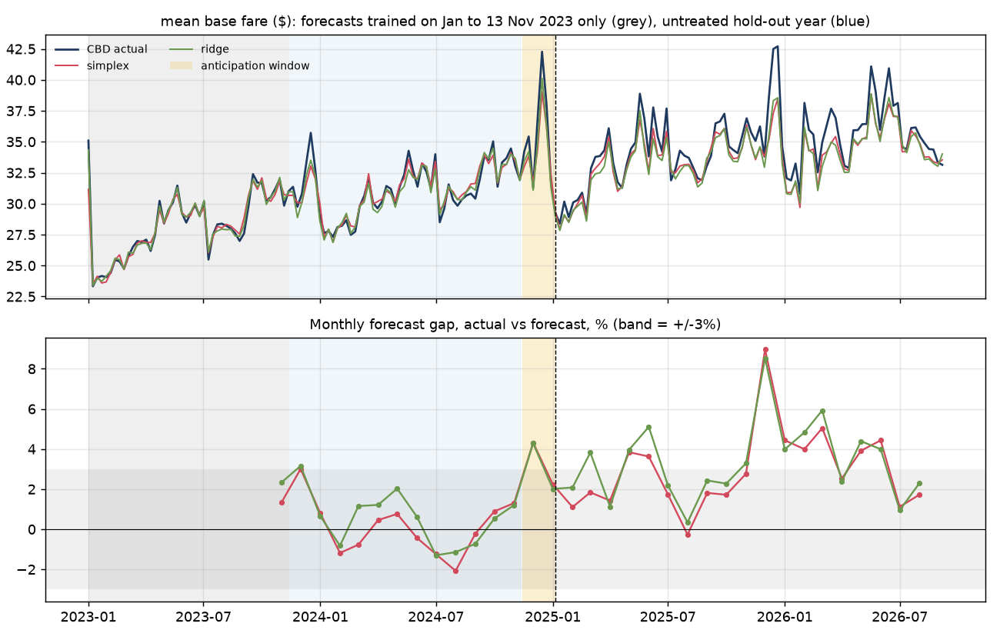

# Congestion pricing and ride-hail in the Manhattan CBD

_Candidate report, run `20261028T032106Z` (2026-10-28T03:21:24+00:00), git `fbfd850b`,
data 2023-01-01 to 2026-08-31 (44 months)._

**Headline.** Relative to the synthetic control, CBD pickups from 2025-01-05 to 2026-01-03 show: trips -5.6% [-15.9, +4.6]; mean wait (s) -1.5% [-4.2, +1.2]; mean base fare ($) +2.0% [-0.5, +4.5] (percent of counterfactual, 95% placebo intervals).

## Question

What happened to ride-hail (Uber and Lyft) activity in the Manhattan Central Business
District when congestion pricing took effect on 2025-01-05: how many trips started
there, how long riders waited, what they paid, what drivers earned? The policy was
announced on 2024-11-14, so the weeks in between are treated as a separate
anticipation period rather than as clean "before" weeks.

## Data

TLC High Volume For-Hire Vehicle trip records, every trip, 2023-01-01 to
2026-08-31. The pipeline streams each monthly file, validates it (schema, row
counts, null rates, timestamps, money, zones, licence codes) and reduces it to a pickup
zone by hour by company panel; the analyses here start from that panel. Outcomes are
daily or weekly ratios of sums, so every number is consistent with every other.

- Treated unit: pickups in the 38 CBD taxi zones (MTA's list, south of 60th St).
- Control zones: 24 Manhattan zones outside the CBD (parks and
  islands excluded) and 27 inner Brooklyn and Queens zones along the
  East River. Airports are never controls. Airport-bound trips remain in the CBD outcomes
  (owner decision pending; `exclude_airport_trips=False`).
- Fare measure: TLC `base_passenger_fare`, which excludes tolls, taxes, fees and the
  congestion fee itself. The fee is tabulated separately in the panel.

## Identification

Three comparisons, all reported (owner design, see METHODS.md):

1. **Prior year.** The same weekdays 364 days earlier, with the CBD's year-over-year
   change divided by the donor pool's year-over-year change. Interval: weekly block
   bootstrap.
2. **Synthetic control.** A weighted combination of control zones that tracks the CBD
   from 2023-01-01 to 2024-11-13
   (the day before the announcement). Weights are non-negative and sum to one on
   mean-scaled daily series. Inference is placebo-in-space: every donor is refitted as if
   treated. The design is first tested on the same calendar window a year earlier
   (2023-11-14 to 2024-01-05), when nothing happened.
3. **Pre-window.** CBD means over the window versus the clean pre-period from
   2024-06-01 to the day before the announcement, with the donor pool's change
   over the same two windows divided out.

Alongside these, a zone-week two-way fixed-effects event study (zone and week effects,
standard errors clustered by zone, 30 leads and 30 lags binned
at the ends) against each control group, with a joint test of the clean leads, fake
treatment dates in 2024 and fake treated zones as placebos.

The post window for the comparisons is the first 364 days after
2025-01-05 (through 2026-01-03), so that the prior-year design never
compares a treated day with another treated day. The event study uses all weeks.

## Results

### Post period (2025-01-05 to 2026-01-03)

Effects on the CBD as a percent of the counterfactual, donor-adjusted, 95% intervals.

| Outcome | prior year | synthetic control | pre-window |
|---|---|---|---|
| trips | -4.6% [-5.2, -3.9] | -5.6% [-15.9, +4.6] | -4.8% [-6.7, -2.8] |
| mean wait (s) | -5.0% [-6.0, -4.1] | -1.5% [-4.2, +1.2] | -5.4% [-7.2, -3.6] |
| mean base fare ($) | +6.1% [+5.6, +6.6] | +2.0% [-0.5, +4.5] | +6.4% [+4.5, +8.5] |
| mean driver pay ($) | +2.7% [+2.4, +3.1] | n/a | +3.2% [+1.5, +4.9] |
| tip rate | -0.1% [-0.5, +0.2] | n/a | -0.2% [-1.0, +0.7] |
| shared-request share | -15.4% [-20.3, -10.3] | n/a | -15.4% [-18.5, -11.9] |

### Anticipation window (2024-11-14 to 2025-01-04)

| Outcome | prior year | synthetic control | pre-window |
|---|---|---|---|
| trips | -4.1% [-8.6, +0.2] | -4.5% [-12.2, +3.1] | -4.0% [-10.0, +1.7] |
| mean wait (s) | -0.9% [-5.2, +2.9] | +1.1% [-3.0, +5.2] | +0.9% [-2.6, +4.8] |
| mean base fare ($) | +5.1% [+2.1, +7.5] | +3.1% [-0.4, +6.6] | +7.3% [+3.0, +12.4] |
| mean driver pay ($) | +2.8% [+0.3, +4.4] | n/a | +6.3% [+3.0, +10.3] |
| tip rate | +0.4% [-1.2, +2.3] | n/a | +0.8% [-1.1, +2.6] |
| shared-request share | -23.0% [-25.8, -19.0] | n/a | -18.6% [-22.8, -14.0] |

### Synthetic control

| Outcome | Pre-RMSPE | Anticipation gap | Post gap | Placebo p (post) | 2023 test gap | Top donors |
|---|---|---|---|---|---|---|
| trips | 8.17e+03 | -4.5% | -5.6% | 0.10 | -3.1% | Williamsburg (South Side) 0.18, Lenox Hill West 0.18, Upper East Side South 0.18, Lincoln Square East 0.15 |
| mean wait (s) | 13.1 | +1.1% | -1.5% | 0.90 | +2.9% | Upper East Side South 0.48, Lincoln Square West 0.24, Williamsburg (North Side) 0.11, DUMBO/Vinegar Hill 0.09 |
| mean base fare ($) | 1.24 | +3.1% | +2.0% | 0.08 | +2.6% | Upper East Side South 0.73, Lenox Hill East 0.11, Downtown Brooklyn/MetroTech 0.11, Lincoln Square East 0.02 |

### Event study

| Outcome | Control group | Anticipation | Post | Pre-trend p |
|---|---|---|---|---|
| trips | manhattan north | -0.079 [-0.096, -0.062] log pts | -0.062 [-0.090, -0.034] log pts | 0.00 |
| mean wait (s) | manhattan north | -3.004 [-9.234, +3.227] | -22.701 [-29.666, -15.735] | 0.00 |
| mean base fare ($) | manhattan north | +2.686 [+1.959, +3.413] | +2.825 [+2.082, +3.567] | 0.00 |
| mean driver pay ($) | manhattan north | +1.175 [+0.835, +1.515] | +0.833 [+0.530, +1.135] | 0.00 |
| tip rate | manhattan north | +0.001 [+0.000, +0.001] | -0.000 [-0.001, +0.000] | 0.00 |
| shared-request share | manhattan north | -0.006 [-0.008, -0.003] | +0.001 [-0.001, +0.004] | 0.00 |
| trips | inner bk queens | -0.094 [-0.120, -0.069] log pts | -0.159 [-0.184, -0.133] log pts | 0.00 |
| mean wait (s) | inner bk queens | +3.832 [-3.573, +11.237] | -20.571 [-24.230, -16.913] | 0.00 |
| mean base fare ($) | inner bk queens | +3.853 [+3.292, +4.414] | +3.478 [+2.955, +4.002] | 0.00 |
| mean driver pay ($) | inner bk queens | +1.929 [+1.637, +2.221] | +1.290 [+1.071, +1.508] | 0.00 |
| tip rate | inner bk queens | +0.001 [+0.000, +0.002] | +0.000 [-0.000, +0.001] | 0.00 |
| shared-request share | inner bk queens | -0.009 [-0.010, -0.007] | -0.003 [-0.004, -0.001] | 0.00 |

## Diagnostics

### The 2023 test of the synthetic control

- **trips**: in the 2023 test window the synthetic CBD missed the actual CBD by -3.1% on average (RMSPE ratio 1.45). Any post-period gap smaller than that in absolute value should not be read as an effect. Placebo-in-space p-value for the post window: 0.10.
- **mean wait (s)**: in the 2023 test window the synthetic CBD missed the actual CBD by +2.9% on average (RMSPE ratio 1.29). Any post-period gap smaller than that in absolute value should not be read as an effect. Placebo-in-space p-value for the post window: 0.90.
- **mean base fare ($)**: in the 2023 test window the synthetic CBD missed the actual CBD by +2.6% on average (RMSPE ratio 1.81). Any post-period gap smaller than that in absolute value should not be read as an effect. Placebo-in-space p-value for the post window: 0.08.

### Out-of-sample test of the synthetic control

Requested in the review of the 2026-08 release.

Each model is trained on 2023-01-01 to 2023-11-13 only and then forecasts forward with its parameters frozen. The year from 2023-11-14 to 2024-11-13 is untreated, so a credible counterfactual should stay on the actual CBD series there. Gaps are actual minus forecast, % of forecast. The placebo column is the share of donor zones whose own hold-out drift is at least as large as the CBD's, when each is forecast from the others the same way; a small share means the CBD's drift is unusual, not just noise.

| Outcome | Model | Train RMSPE | Hold-out gap | Last quarter of hold-out | Anticipation gap | Post gap | Donor share | Within tolerance |
|---|---|---|---|---|---|---|---|---|
| trips | simplex weights (current design) | 4.4% | -4.0% | -4.7% | -6.8% | -8.5% | 0.12 | no |
| trips | ridge regression | 4.0% | -3.5% | -4.8% | -5.8% | -8.0% | 0.17 | no |
| mean wait (s) | simplex weights (current design) | 4.6% | +1.4% | +1.9% | +2.6% | -0.5% | 0.27 | yes |
| mean wait (s) | ridge regression | 3.3% | +2.6% | +3.1% | +2.9% | +0.9% | 0.12 | no |
| mean base fare ($) | simplex weights (current design) | 3.5% | +0.1% | -0.2% | +3.4% | +2.7% | 0.88 | yes |
| mean base fare ($) | ridge regression | 2.3% | +0.6% | -0.3% | +3.3% | +3.2% | 0.52 | yes |

- **trips**: no model stays within tolerance over the untreated year. Its anticipation and post gaps cannot be separated from drift with these donors. If the drift simply continued at its last-quarter rate of -4.7%, the post gap of -8.5% would be about -3.8% net of it; that is an assumption, not an estimate.
- **mean wait (s)**: within tolerance out of sample: simplex weights (current design).
- **mean base fare ($)**: within tolerance out of sample: simplex weights (current design), ridge regression.

### Pre-trends

The joint test of the clean leads in the event study is reported per outcome and control
group in the table above (column "Pre-trend p"). A small p-value means the CBD and the
control group were already moving differently before the announcement, after zone and
week effects; the dynamic plots show where. Where that happens the fixed-effects estimate
should be read with the synthetic control, which re-weights donors to match the CBD's
pre-period path.

### Placebo tests

Static post coefficients when the treatment date is moved to a fake date in 2024 (using
only pre-announcement data), and when the treated zones are a random third of the control
group (true dates). The share of placebo estimates with p < 0.05 should be near 5%; a
higher share means the clustered standard errors understate the noise for that outcome.

**Fake treatment dates in 2024 produce significant 'effects' for: trips (vs inner bk queens); mean base fare ($) (vs manhattan north, inner bk queens); mean driver pay ($) (vs manhattan north, inner bk queens); shared-request share (vs manhattan north, inner bk queens).** For those outcomes the CBD was already diverging from the control group before the announcement, and the fixed-effects post estimate measures that divergence as much as the policy. Read the synthetic control and prior-year comparisons for them instead.

| Kind | Outcome | Control group | n | Mean estimate | Largest abs | Share p < 0.05 |
|---|---|---|---|---|---|---|
| fake date | trips | inner bk queens | 3 | -0.075 | 0.084 | 100% |
| fake date | trips | manhattan north | 3 | -0.009 | 0.020 | 33% |
| fake date | mean wait (s) | inner bk queens | 3 | +3.270 | 6.750 | 33% |
| fake date | mean wait (s) | manhattan north | 3 | +3.117 | 7.230 | 33% |
| fake date | mean base fare ($) | inner bk queens | 3 | +1.684 | 2.219 | 100% |
| fake date | mean base fare ($) | manhattan north | 3 | +1.475 | 2.003 | 100% |
| fake date | mean driver pay ($) | inner bk queens | 3 | +0.495 | 0.914 | 100% |
| fake date | mean driver pay ($) | manhattan north | 3 | +0.360 | 0.719 | 100% |
| fake date | tip rate | inner bk queens | 3 | +0.000 | 0.001 | 33% |
| fake date | tip rate | manhattan north | 3 | -0.000 | 0.000 | 0% |
| fake date | shared-request share | inner bk queens | 3 | -0.002 | 0.003 | 67% |
| fake date | shared-request share | manhattan north | 3 | -0.002 | 0.003 | 100% |
| fake zones | trips | inner bk queens | 20 | -0.003 | 0.048 | 5% |
| fake zones | trips | manhattan north | 20 | -0.006 | 0.046 | 5% |
| fake zones | mean wait (s) | inner bk queens | 20 | -0.632 | 5.314 | 0% |
| fake zones | mean wait (s) | manhattan north | 20 | -0.013 | 15.490 | 5% |
| fake zones | mean base fare ($) | inner bk queens | 20 | +0.118 | 0.499 | 0% |
| fake zones | mean base fare ($) | manhattan north | 20 | -0.032 | 1.014 | 0% |

## Limitations

- This is an aggregate zone-level design. It identifies the change in CBD pickups relative
  to a counterfactual built from other zones; it does not separate riders who switched
  mode from riders who switched pickup location to just outside the CBD. Spillover to the
  control zones would bias the estimates towards finding larger effects.
- The anticipation window overlaps the holiday season, where the CBD's pattern differs
  from the control zones' (visible in the event-study plots at Thanksgiving and Christmas).
  The prior-year design handles this best; the pre-window design least.
- The synthetic control's 2023 test gap bounds what the design can resolve. Its
  placebo-in-space interval is built from single-zone placebos, which are noisier than
  the 38-zone CBD aggregate, so that interval is conservative (too wide) and the prior-year
  and pre-window bootstraps are the tighter guide to sampling noise.
- Airport-bound trips are included in the CBD means (owner decision pending).
- Benchmark comparison with published estimates: **placeholder, owner to supply**.

## What the reviewer should look at

1. The three post-period estimates for trips, wait and fare: do they agree in sign and
   roughly in size? Where they disagree, the diagnostics say which to trust.
2. The 2023 test gaps and the placebo-in-space p-values.
3. The pre-trend p-values and the dynamic plots: is there a visible break at the
   announcement, at the treatment date, or at neither?
4. The validation table and the "What changed" table below.

## Review dashboard

### Validation of the months in this run

| Month | Status | Rows | Failed or warned checks |
|---|---|---|---|
| 2023-01 | pass | 18,479,031 | none |
| 2023-02 | pass | 17,960,971 | none |
| 2023-03 | pass | 20,413,539 | none |
| 2023-04 | pass | 19,144,903 | none |
| 2023-05 | pass | 19,847,676 | none |
| 2023-06 | pass | 19,366,619 | none |
| 2023-07 | pass | 19,132,131 | none |
| 2023-08 | pass | 18,322,150 | none |
| 2023-09 | pass | 19,851,123 | none |
| 2023-10 | pass | 20,186,330 | none |
| 2023-11 | pass | 19,269,250 | none |
| 2023-12 | pass | 20,516,297 | none |
| 2024-01 | pass | 19,663,930 | none |
| 2024-02 | pass | 19,359,148 | none |
| 2024-03 | pass | 21,280,788 | none |
| 2024-04 | pass | 19,733,038 | none |
| 2024-05 | pass | 20,704,538 | none |
| 2024-06 | pass | 20,123,226 | none |
| 2024-07 | pass | 19,182,934 | none |
| 2024-08 | pass | 19,128,392 | none |
| 2024-09 | pass | 19,209,788 | none |
| 2024-10 | pass | 20,028,282 | none |
| 2024-11 | pass | 19,987,533 | none |
| 2024-12 | pass | 21,068,851 | none |
| 2025-01 | pass | 20,405,666 | none |
| 2025-02 | pass | 19,339,461 | none |
| 2025-03 | warn | 20,536,879 | null_rate_band:on_scene_datetime |
| 2025-04 | warn | 19,753,983 | null_rate_band:on_scene_datetime |
| 2025-05 | warn | 21,091,193 | null_rate_band:on_scene_datetime |
| 2025-06 | warn | 19,868,009 | null_rate_band:on_scene_datetime |
| 2025-07 | warn | 19,653,012 | null_rate_band:on_scene_datetime |
| 2025-08 | warn | 19,271,461 | null_rate_band:on_scene_datetime |
| 2025-09 | warn | 19,434,641 | null_rate_band:on_scene_datetime |
| 2025-10 | warn | 21,308,701 | null_rate_band:on_scene_datetime |
| 2025-11 | warn | 20,818,240 | null_rate_band:on_scene_datetime |
| 2025-12 | warn | 22,108,438 | null_rate_band:on_scene_datetime |
| 2026-01 | warn | 20,940,373 | null_rate_band:on_scene_datetime |
| 2026-02 | warn | 19,875,686 | null_rate_band:on_scene_datetime |
| 2026-03 | warn | 22,058,358 | null_rate_band:on_scene_datetime |
| 2026-04 | warn | 20,995,953 | null_rate_band:on_scene_datetime |
| 2026-05 | warn | 22,125,744 | null_rate_band:on_scene_datetime |
| 2026-06 | warn | 20,775,868 | null_rate_band:on_scene_datetime |
| 2026-07 | warn | 20,921,249 | null_rate_band:on_scene_datetime |
| 2026-08 | warn | 20,493,480 | null_rate_band:on_scene_datetime |

### What changed since the last approved release

_No approved release yet; this is the first candidate._

### Run record

| Field | Value |
|---|---|
| Run id | `20261028T032106Z` |
| Git SHA | `fbfd850b750831b6e9b867677144f61ccd674370` |
| Manifest hash | `d37e7e914398720f4c452eb5c71a44658116880ba69b517a50cc9a9818772976` |
| Package version | 0.1.0 |
| Analysis wall time | 18.8 s |
